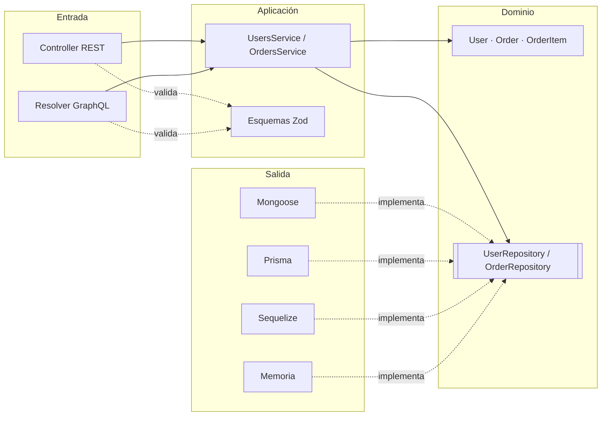
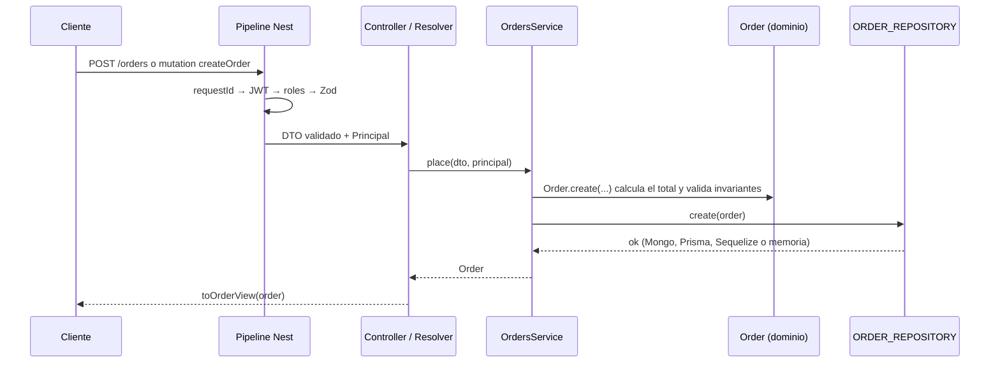
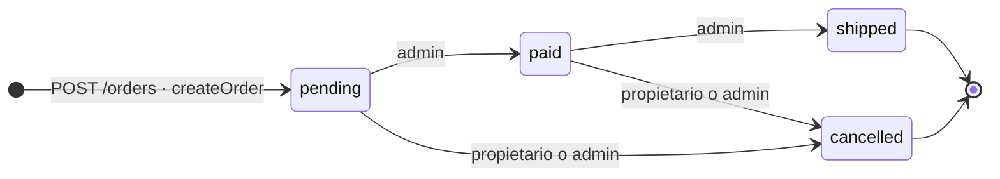

# 2. Arquitectura, capas, REST y GraphQL

> [!TIP]
> En visual: [arquitectura hexagonal](diagrams/01-arquitectura-hexagonal.html), [secuencia REST](diagrams/02-secuencia-rest-crear-pedido.html), [secuencia GraphQL](diagrams/03-secuencia-graphql-estado-pedido.html) y [ciclo de vida del pedido](diagrams/04-ciclo-de-vida-pedido.html) ([vistas previas](diagrams/README.md)).

## Screaming Architecture

Las carpetas de primer nivel cuentan **de qué va el sistema** (usuarios, pedidos, autenticación). Dentro de cada una se repiten las mismas capas:

```text
src/users/
├── domain/                     TypeScript puro: sin Nest, sin ORM
│   ├── user.ts                 agregado (entidad) con sus invariantes
│   ├── user.criteria.ts        criterio de búsqueda (patrón Criteria)
│   ├── user.repository.ts      PUERTO + token USER_REPOSITORY
│   └── user.errors.ts          errores de negocio
├── application/                casos de uso
│   ├── user.schemas.ts         DTO de entrada y vistas de salida con Zod
│   ├── users.service.ts        orquesta el dominio a través de los puertos
│   └── admin.seeder.ts
├── infrastructure/persistence/ ADAPTADORES de salida
│   ├── user-repository.adapters.ts   registro driver → adaptador
│   ├── in-memory/              in-memory-user.repository.ts
│   ├── mongoose/               user.document.ts · user-document.mapper.ts · mongoose-user.repository.ts
│   ├── prisma/                 user-record.mapper.ts · prisma-user.repository.ts
│   └── sequelize/              user.model.ts · user-model.mapper.ts · sequelize-user.repository.ts
├── presentation/               ADAPTADORES de entrada
│   ├── user.presenter.ts       vista pública compartida por REST y GraphQL
│   ├── http/users.controller.ts
│   └── graphql/                user.types.ts · users.resolver.ts
└── users.module.ts
```

`orders/` sigue exactamente la misma estructura. `auth/` añade dos puertos más (`TokenService`, `PasswordHasher`) con sus adaptadores (`jsonwebtoken`, `scrypt`).

## Regla de dependencias



Las flechas apuntan **hacia el dominio**. El dominio no importa nada de las capas externas; la aplicación solo usa la inyección de dependencias de Nest (`@Injectable`, `@Inject`), una concesión pragmática.

## Una petición, de punta a punta



## Zod como única fuente de verdad

```ts
@Post()
place(@Body({ schema: createOrderSchema }) dto: CreateOrderDto) { ... }

@Mutation(() => OrderType)
createOrder(@Args('input', { type: () => CreateOrderInput }, new ArgsSchemaPipe(createOrderSchema)) input: CreateOrderDto) { ... }
```

- **REST**: NestJS 12 acepta la opción `schema` (Standard Schema) en `@Body`, `@Query` y `@Param`, y la valida el `StandardSchemaValidationPipe` global.
- **GraphQL**: `@Args()` no tiene esa opción, así que `ArgsSchemaPipe` la inyecta y delega en el mismo pipe nativo.
- **OpenAPI**: `@nestjs/swagger` 12 convierte esos mismos esquemas a `components.schemas`.
- Las clases `@InputType`/`@ObjectType` solo describen el **transporte** GraphQL; las reglas viven en Zod.

## Endpoints REST

| Método | Ruta | Acceso | Descripción |
|---|---|---|---|
| POST | `/auth/register` | público | Registro de cliente |
| POST | `/auth/login` | público | Devuelve `{ accessToken, tokenType, expiresIn }` |
| GET | `/auth/me` | autenticado | Perfil propio |
| POST | `/users` | admin | Alta con rol |
| GET | `/users?role&page&limit&sort` | admin | Listado paginado |
| GET | `/users/:id` | admin o propietario | Detalle |
| PATCH | `/users/:id` | admin o propietario | Edición parcial; el rol solo lo cambia admin |
| DELETE | `/users/:id` | admin | Baja (204) |
| POST | `/orders` | autenticado | Crea un pedido propio en `pending` |
| GET | `/orders?userId&status&minTotalCents&maxTotalCents&page&limit&sort` | autenticado | Filtros ESR; el cliente solo ve los suyos |
| GET | `/orders/:id` | admin o propietario | Detalle |
| PATCH | `/orders/:id/status` | admin; el cliente solo `cancelled` | Máquina de estados |
| DELETE | `/orders/:id` | admin | Baja (204) |

Los errores siguen **RFC 9457 (Problem Details)**: `{ type, title, status, detail, code, instance, requestId, errors? }`.

## Operaciones GraphQL (espejo de REST)

| Tipo | Operación | Equivale a |
|---|---|---|
| Mutation | `register(input)`, `login(input)` | `POST /auth/register`, `POST /auth/login` |
| Query | `me` | `GET /auth/me` |
| Mutation | `createUser`, `updateUser`, `deleteUser` | `POST`, `PATCH`, `DELETE /users` |
| Query | `users(filter)`, `user(id)` | `GET /users`, `GET /users/:id` |
| Mutation | `createOrder`, `updateOrderStatus`, `deleteOrder` | `POST`, `PATCH`, `DELETE /orders` |
| Query | `orders(filter)`, `order(id)` | `GET /orders`, `GET /orders/:id` |

Los errores llevan el **mismo código** que REST en `errors[].extensions.code` (`BAD_USER_INPUT`, `UNAUTHENTICATED`, `FORBIDDEN`, `NOT_FOUND`, `CONFLICT`, `BUSINESS_RULE`). Los enums siguen la convención GraphQL en mayúsculas (`PENDING`) y se mapean a los valores del dominio (`pending`).

## Ciclo de vida del pedido

La máquina de estados vive en el dominio (`orders/domain/order-status.ts`) como una tabla de transiciones. REST y GraphQL llegan al mismo `OrdersService.changeStatus`, que comprueba por este orden: que el pedido existe (404), que es tuyo o eres ADMIN (403), que un cliente solo pide `cancelled` (403) y que la transición está en la tabla (422).



> [!NOTE]
> `shipped` y `cancelled` son terminales: cualquier transición desde ellos responde `BUSINESS_RULE` (422) y el pedido no cambia.

## SQL frente a NoSQL dentro del mismo proyecto

| Aspecto | MongoDB (Mongoose) | PostgreSQL (Prisma / Sequelize) |
|---|---|---|
| Líneas del pedido | Array embebido en `orders`: una lectura, sin JOIN | Tabla `order_items` con PK `(order_id, position)` y FK |
| Lectura del pedido | `findById().lean()` | Prisma: `include` (consulta por lote). Sequelize: `include` con JOIN |
| Atomicidad del alta | Un documento es atómico por definición | Prisma: *nested create*. Sequelize: transacción explícita |
| Unicidad del email | Índice único → E11000 | `UNIQUE` → P2002 / `UniqueConstraintError` |
| Invariantes en BBDD | `min`, `enum` en el esquema | `CHECK`, `ENUM`, `NOT NULL` en la migración |
| Esquema | En el código (Mongoose) | Migración SQL versionada |

El dominio es idéntico en los dos mundos. Solo cambian los adaptadores, y esa es la tesis del proyecto.

## Añadir una base de datos nueva (Open/Closed)

1. Conexión en `shared/infrastructure/database/` y su entrada en `CONNECTIONS`.
2. Valor nuevo en `DATABASE_DRIVERS`.
3. Por cada agregado, modelo + mapper + repositorio que implemente el puerto.
4. Registrar la clase en `USER_REPOSITORY_ADAPTERS` y `ORDER_REPOSITORY_ADAPTERS`.
5. Pasar el contrato: añadir el driver en `availableDrivers()` de los tests.

Servicios, controllers, resolvers, esquemas y e2e no se modifican.

---

[← Patrones y buenas prácticas](01-patrones-y-buenas-practicas.md) · [Índice](../README.md#documentación) · [Auth con JWT y el pipeline de Nest →](03-auth-jwt-y-pipeline.md)
