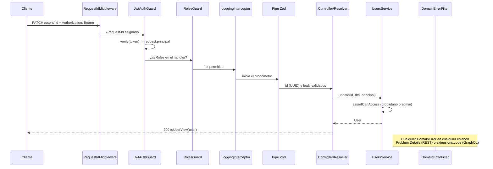

# 3. CRUD de usuarios con JWT (`jsonwebtoken`) y el pipeline de Nest por capas

> [!TIP]
> En visual: [secuencia REST con guards y Zod](https://jmrg-link.github.io/nest-hexagonal-adapters/diagrams/02-secuencia-rest-crear-pedido.html), [manejo de errores](https://jmrg-link.github.io/nest-hexagonal-adapters/diagrams/05-manejo-de-errores.html) y [políticas de acceso del dominio](https://jmrg-link.github.io/nest-hexagonal-adapters/diagrams/06-dominio-y-reglas-de-negocio.html) ([vistas previas](diagrams/README.md)).

## Piezas y capa de cada una

| Pieza | Capa | Fichero |
|---|---|---|
| `TokenService` (puerto) | dominio | `auth/domain/token-service.port.ts` |
| `PasswordHasher` (puerto) | dominio | `auth/domain/password-hasher.port.ts` |
| `JsonWebTokenService` (adaptador, librería `jsonwebtoken`) | infraestructura | `auth/infrastructure/jsonwebtoken-token.service.ts` |
| `ScryptPasswordHasher` (adaptador, `node:crypto`) | infraestructura | `auth/infrastructure/scrypt-password.hasher.ts` |
| `AuthService`: registro, login, perfil | aplicación | `auth/application/auth.service.ts` |
| `UsersService`: CRUD y reglas de propiedad | aplicación | `users/application/users.service.ts` |
| `JwtAuthGuard`, `RolesGuard`, decoradores | presentación | `auth/presentation/*` |

Se usa `jsonwebtoken` directamente (no `jose` ni `@nestjs/jwt`), detrás de un puerto. Cambiar a `jose` o a un KMS sería escribir otro adaptador de `TokenService`, sin tocar casos de uso ni guards.

## Emisión y verificación del token

```ts
sign({ email, role }, secret, {
  algorithm: 'HS256', subject: userId, expiresIn: 900, issuer, audience,
});

verify(token, secret, { algorithms: ['HS256'], issuer, audience });
claimsSchema.parse(payload);
```

- **Algoritmo fijado al verificar** para evitar la confusión de `alg` (por ejemplo `none` o RS/HS).
- **`iss` y `aud`** evitan aceptar tokens emitidos para otra API.
- **Caducidad corta** (15 minutos por defecto, `JWT_EXPIRES_IN_SECONDS`).
- **Claims validados con Zod**: no se confía en un JSON solo porque la firma sea correcta.
- **Secreto de al menos 32 caracteres**, exigido por la validación del entorno.

## Contraseñas

- `scrypt` con sal aleatoria de 16 bytes y coste configurable (`SCRYPT_COST`; OWASP recomienda 2^17).
- Formato autodescriptivo `scrypt$N$r$p$sal$clave`: se puede subir el coste sin invalidar hashes antiguos.
- Comparación en tiempo constante (`timingSafeEqual`).
- El hash nunca sale de la aplicación: el presenter es una lista blanca de campos.

## Flujo completo



## El pipeline de Nest, eslabón a eslabón

| Orden | Eslabón | Aquí | Responsabilidad | Registro |
|---|---|---|---|---|
| 1 | **Middleware** | `RequestIdMiddleware` | Correlación: `x-request-id` | `AppModule.configure()` |
| 2 | **Guard** | `JwtAuthGuard` | ¿Quién eres? (autenticación) | `APP_GUARD` en `AuthModule` |
| 3 | **Guard** | `RolesGuard` | ¿Qué rol tienes? (RBAC) | `APP_GUARD`, después del anterior |
| 4 | **Interceptor** | `LoggingInterceptor` | Log con requestId y duración (AOP) | `APP_INTERCEPTOR` |
| 5 | **Pipe** | `StandardSchemaValidationPipe` / `ArgsSchemaPipe` | Validación y transformación con Zod | `APP_PIPE` (REST) y por argumento (GraphQL) |
| 6 | **Handler** | Controller o resolver | Traduce transporte ↔ caso de uso | — |
| 7 | **Filtro** | `DomainErrorFilter` | Error de dominio → HTTP/GraphQL | `APP_FILTER` |

Dos niveles de autorización, cada uno en su capa:
- **Por rol** (presentación): `@Roles('admin')` + `RolesGuard`.
- **Por propiedad del recurso** (aplicación): `assertCanAccess(principal, ownerId)`, porque necesita cargar el recurso.

Guards, decoradores e interceptor funcionan igual en REST y GraphQL gracias a `getRequest(context)` en `shared/presentation/request-context.ts`.

## Reglas del CRUD de usuarios

| Operación | Cliente | Admin |
|---|---|---|
| Registrarse (`POST /auth/register`) | ✅ siempre como `customer` | ✅ |
| Ver su perfil (`GET /auth/me`, `GET /users/:id` propio) | ✅ | ✅ cualquiera |
| Editar nombre, email o contraseña propios | ✅ | ✅ cualquiera |
| Cambiar rol | ❌ 403 | ✅ |
| Listar y crear usuarios | ❌ 403 | ✅ |
| Eliminar usuario | ❌ 403 | ✅ (los pedidos se conservan) |

## Probarlo con curl

```bash
B=http://localhost:3000

curl -s -X POST $B/auth/register -H 'content-type: application/json' \
  -d '{"email":"ana@mail.com","name":"Ana","password":"supersecret"}'

TOKEN=$(curl -s -X POST $B/auth/login -H 'content-type: application/json' \
  -d '{"email":"ana@mail.com","password":"supersecret"}' | jq -r .accessToken)

curl -s $B/auth/me -H "authorization: Bearer $TOKEN"
curl -s -X PATCH $B/users/<id> -H "authorization: Bearer $TOKEN" \
  -H 'content-type: application/json' -d '{"name":"Ana María"}'
```

Lo mismo en GraphQL:

```graphql
mutation { login(input: { email: "ana@mail.com", password: "supersecret" }) { accessToken expiresIn } }

query { me { id email role createdAt } }

mutation { updateUser(id: "<id>", input: { name: "Ana María" }) { id name updatedAt } }
```

Cabecera HTTP en GraphiQL o Postman: `{ "Authorization": "Bearer <token>" }`.

## Siguientes pasos de seguridad (fuera del alcance, a propósito)

- **Refresh tokens** con rotación y revocación, guardados como hash.
- **Rate limiting** en login y registro (`@nestjs/throttler`, con un guard compatible con GraphQL).
- **RS256 + JWKS** si varios servicios verifican tokens sin compartir secreto.
- **Hash señuelo** en el login para igualar tiempos cuando el email no existe.
- Bloqueo progresivo de cuenta y auditoría de accesos.

---

[← Arquitectura, capas, REST y GraphQL](02-arquitectura-rest-graphql.md) · [Índice](../README.md#documentación) · [Regla ESR e índices →](04-esr-e-indices.md)
