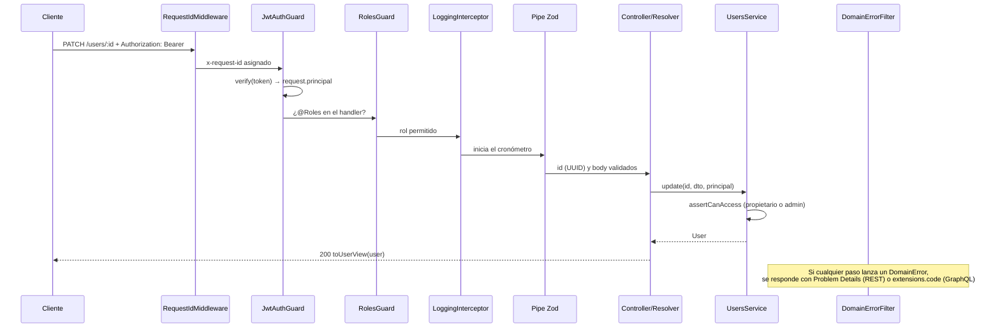

# 3. Autenticación con JWT y el pipeline de Nest

> [!TIP]
> Los diagramas de [secuencia REST con guards y Zod](https://jmrg-link.github.io/nest-hexagonal-adapters/diagrams/02-secuencia-rest-crear-pedido.html), [manejo de errores](https://jmrg-link.github.io/nest-hexagonal-adapters/diagrams/05-manejo-de-errores.html) y [políticas de acceso del dominio](https://jmrg-link.github.io/nest-hexagonal-adapters/diagrams/06-dominio-y-reglas-de-negocio.html) muestran lo mismo de forma visual ([vistas previas](diagrams/README.md)).

## Piezas y capa de cada una

| Pieza | Capa | Fichero |
|---|---|---|
| `TokenService` (puerto) | dominio | `auth/domain/token-service.port.ts` |
| `PasswordHasher` (puerto) | dominio | `auth/domain/password-hasher.port.ts` |
| `JsonWebTokenService` (adaptador, librería `jsonwebtoken`) | infraestructura | `auth/infrastructure/jsonwebtoken-token.service.ts` |
| `ScryptPasswordHasher` (adaptador, `node:crypto`) | infraestructura | `auth/infrastructure/scrypt-password.hasher.ts` |
| `AuthService`: registro, login, perfil | aplicación | `auth/application/auth.service.ts` |
| `UsersService`: CRUD y reglas de propiedad | aplicación | `users/application/users.service.ts` |
| `JwtAuthGuard`, `RolesGuard`, decoradores | presentación | `auth/presentation/*` |

El token se firma con la librería `jsonwebtoken`, sin `@nestjs/jwt` ni `jose`, y el resto de la aplicación la usa a través de un puerto. Cambiar a `jose` o a un KMS solo exigiría escribir otro adaptador de `TokenService`; los casos de uso y los guards no cambiarían.

## Emisión y verificación del token

```ts
sign({ email, role }, secret, {
  algorithm: 'HS256', subject: userId, expiresIn: 900, issuer, audience,
});

verify(token, secret, { algorithms: ['HS256'], issuer, audience });
claimsSchema.parse(payload);
```

- Al verificar se exige HS256, así que no se acepta un token que declare otro algoritmo, como `none` o uno asimétrico.
- `iss` y `aud` identifican a esta API: un token emitido para otra se rechaza.
- El token caduca a los 15 minutos por defecto (`JWT_EXPIRES_IN_SECONDS`).
- El contenido del token se valida con Zod después de comprobar la firma, en lugar de dar por bueno cualquier JSON firmado.
- El secreto debe tener al menos 32 caracteres; si no, la aplicación no arranca.

## Contraseñas

- Se guardan con `scrypt`, una sal aleatoria de 16 bytes y un coste configurable (`SCRYPT_COST`; OWASP recomienda 2^17).
- Cada hash guarda sus propios parámetros (`scrypt$N$r$p$sal$clave`), así que se puede subir el coste sin invalidar las contraseñas que ya existen.
- La comparación tarda lo mismo acierte o falle (`timingSafeEqual`), para no dar pistas por el tiempo de respuesta.
- El hash nunca se devuelve: el presenter solo expone una lista cerrada de campos.

## Recorrido de una petición autenticada



## El pipeline de Nest, paso a paso

| Orden | Tipo | Clase | Qué hace | Dónde se registra |
|---|---|---|---|---|
| 1 | **Middleware** | `RequestIdMiddleware` | Asigna un `x-request-id` para seguir la petición en los logs | `AppModule.configure()` |
| 2 | **Guard** | `JwtAuthGuard` | Comprueba el token (autenticación) | `APP_GUARD` en `AuthModule` |
| 3 | **Guard** | `RolesGuard` | Comprueba el rol (RBAC) | `APP_GUARD`, después del anterior |
| 4 | **Interceptor** | `LoggingInterceptor` | Registra cada petición con su requestId y su duración | `APP_INTERCEPTOR` |
| 5 | **Pipe** | `StandardSchemaValidationPipe` / `ArgsSchemaPipe` | Valida y transforma la entrada con Zod | `APP_PIPE` (REST) y por argumento (GraphQL) |
| 6 | **Handler** | Controller o resolver | Pasa la petición al caso de uso y devuelve su resultado | — |
| 7 | **Filtro** | `DomainErrorFilter` | Convierte el error de dominio en respuesta HTTP o GraphQL | `APP_FILTER` |

La autorización se comprueba en dos sitios:
- **Por rol** (presentación): `@Roles('admin')` + `RolesGuard`.
- **Por propiedad del recurso** (aplicación): `assertCanAccess(principal, ownerId)`. Va en el servicio porque antes hay que cargar el recurso para saber de quién es.

Guards, decoradores e interceptor sirven para REST y para GraphQL porque obtienen la petición con `getRequest(context)` (`shared/presentation/request-context.ts`), que funciona en los dos.

## Reglas del CRUD de usuarios

| Operación | Cliente | Admin |
|---|---|---|
| Registrarse (`POST /auth/register`) | ✅ siempre como `customer` | ✅ |
| Ver su perfil (`GET /auth/me`, `GET /users/:id` propio) | ✅ | ✅ cualquiera |
| Editar nombre, email o contraseña propios | ✅ | ✅ cualquiera |
| Cambiar rol | ❌ 403 | ✅ |
| Listar y crear usuarios | ❌ 403 | ✅ |
| Eliminar usuario | ❌ 403 | ✅ (los pedidos se conservan) |

## Probarlo con curl

```bash
B=http://localhost:3000

curl -s -X POST $B/auth/register -H 'content-type: application/json' \
  -d '{"email":"ana@mail.com","name":"Ana","password":"supersecret"}'

TOKEN=$(curl -s -X POST $B/auth/login -H 'content-type: application/json' \
  -d '{"email":"ana@mail.com","password":"supersecret"}' | jq -r .accessToken)

curl -s $B/auth/me -H "authorization: Bearer $TOKEN"
curl -s -X PATCH $B/users/<id> -H "authorization: Bearer $TOKEN" \
  -H 'content-type: application/json' -d '{"name":"Ana María"}'
```

Lo mismo en GraphQL:

```graphql
mutation { login(input: { email: "ana@mail.com", password: "supersecret" }) { accessToken expiresIn } }

query { me { id email role createdAt } }

mutation { updateUser(id: "<id>", input: { name: "Ana María" }) { id name updatedAt } }
```

Cabecera HTTP en GraphiQL o Postman: `{ "Authorization": "Bearer <token>" }`.

## Mejoras de seguridad que no están implementadas

Quedan fuera del alcance de este proyecto:

- **Refresh tokens** con rotación y revocación, guardados como hash.
- **Rate limiting** en login y registro (`@nestjs/throttler`, con un guard compatible con GraphQL).
- **RS256 + JWKS** si varios servicios verifican tokens sin compartir secreto.
- **Hash señuelo** en el login para igualar tiempos cuando el email no existe.
- Bloqueo progresivo de cuenta y auditoría de accesos.

---

[← Arquitectura, capas, REST y GraphQL](02-arquitectura-rest-graphql.md) · [Índice](../README.md#documentación) · [Regla ESR e índices →](04-esr-e-indices.md)
