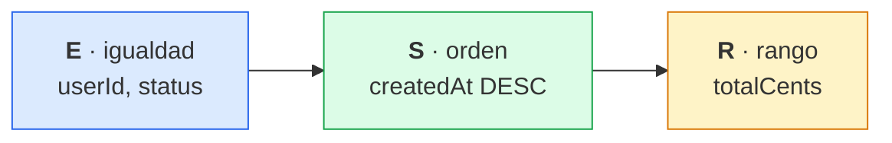

# 4. Regla ESR e índices: MongoDB vs PostgreSQL

## La regla

**ESR = Equality, Sort, Range**: el orden de los campos de un índice compuesto.

1. **E**: los campos de igualdad acotan un tramo contiguo del índice.
2. **S**: dentro de ese tramo el índice ya viene ordenado, así que no hace falta ordenar en memoria.
3. **R**: el rango se filtra mientras se recorre. Si va antes del campo de orden, se rompe el orden y aparece un *sort* bloqueante.

`$ne`, `$nin` y `$regex` cuentan como rango.

> [!TIP]
> ESR es una guía, no una ley: si el rango es muy selectivo, E-R-S puede escanear menos. Decide el `explain()`.

## El patrón de acceso del proyecto

"Pedidos de un usuario, opcionalmente por estado, del más reciente al más antiguo y con un rango de importe":

```ts
orders.search({ userId, status, minTotalCents, maxTotalCents, sort: 'desc', page, limit });
```

| Campo | Papel ESR |
|---|---|
| `userId`, `status` | **E** |
| `createdAt` | **S** |
| `totalCents` | **R** |



En GraphQL, ese patrón es el filtro de `orders` ([captura con variables](capturas/imagenes/09-orders-variables.png)).

`totalCents` es un valor derivado (lo calcula el agregado) que **se desnormaliza** precisamente para poder indexarlo y filtrar por rango.

## Los mismos índices en cada base de datos

**MongoDB**, en `orders/infrastructure/persistence/mongoose/order.document.ts`:

```ts
orderSchema.index({ userId: 1, status: 1, createdAt: -1, totalCents: 1 });
orderSchema.index({ userId: 1, createdAt: -1, totalCents: 1 });
```

**PostgreSQL**, en `prisma/schema.prisma` y `prisma/migrations/.../migration.sql`:

```prisma
@@index([userId, status, createdAt(sort: Desc), totalCents])
@@index([userId, createdAt(sort: Desc), totalCents])
```

¿Por qué dos índices? `status` es opcional. Sin él, el primer índice ya no entrega el orden por `createdAt`: el siguiente campo sería `status`. El segundo cubre ese caso. Cada índice cuesta en escrituras y en memoria, así que se crean para los accesos reales, no para todos los imaginables. Para los listados globales del backoffice (sin `userId`) haría falta otro índice, `{ status: 1, createdAt: -1, totalCents: 1 }`.

En usuarios: `{ email: 1 }` único (login) y `{ role: 1, createdAt: -1 }` (E + S para el listado del admin).

## Cómo comprobarlo

**MongoDB**:

```js
db.orders.find({ userId: "<uuid>", status: "pending", totalCents: { $gte: 1000 } })
  .sort({ createdAt: -1 })
  .explain("executionStats")
```

Buscas `IXSCAN` (no `COLLSCAN`), **ninguna etapa `SORT`** y `totalKeysExamined` cercano a `nReturned`.

**PostgreSQL**:

```sql
EXPLAIN (ANALYZE, BUFFERS)
SELECT * FROM orders
WHERE user_id = '<uuid>' AND status = 'pending' AND total_cents >= 1000
ORDER BY created_at DESC
LIMIT 20;
```

Buscas `Index Scan using orders_user_id_status_created_at_total_cents_idx` **sin nodo `Sort`**. Con pocas filas el planner puede preferir un `Seq Scan`, que es lo correcto en tablas pequeñas.

## Matiz con `$facet` (agregaciones)

Los sub-pipelines de `$facet` no usan índices. Si `$facet` es la primera etapa, hace `COLLSCAN`. Lo correcto es poner antes un `$match` y un `$sort` que sí usen un índice diseñado con ESR, y que `$facet` trabaje solo sobre ese subconjunto.

## Siguiente mejora: paginación por cursor (keyset)

Con `skip` el coste crece con el número de página. La alternativa es paginar por `(createdAt, id)`: `WHERE (created_at, id) < ($1, $2) ORDER BY created_at DESC, id DESC LIMIT 20`, añadiendo `id` al índice como desempate.

---

[← Auth con JWT y el pipeline de Nest](03-auth-jwt-y-pipeline.md) · [Índice](../README.md#documentación) · [OpenAPI, Postman y GraphQL →](05-openapi-postman-graphql.md)
