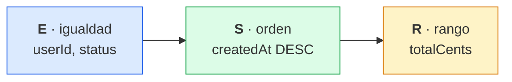

# 4. Regla ESR e índices en MongoDB y PostgreSQL

## La regla

ESR (*Equality, Sort, Range*) es una regla para ordenar los campos de un índice compuesto: primero los de igualdad, después el de orden y al final el de rango.

1. **E**: los campos de igualdad acotan un tramo contiguo del índice.
2. **S**: dentro de ese tramo el índice ya viene ordenado, así que no hace falta ordenar en memoria.
3. **R**: el rango se filtra mientras se recorre. Si se pusiera antes del campo de orden, el índice dejaría de entregar los resultados ordenados y la base de datos tendría que ordenarlos en memoria.

`$ne`, `$nin` y `$regex` cuentan como rango.

> [!TIP]
> La regla es orientativa: si el filtro de rango descarta casi todos los documentos, el orden E-R-S puede recorrer menos entradas. Lo que decide es medirlo con `explain()`.

## El patrón de acceso del proyecto

La consulta principal es «pedidos de un usuario, opcionalmente por estado, del más reciente al más antiguo y con un rango de importe»:

```ts
orders.search({ userId, status, minTotalCents, maxTotalCents, sort: 'desc', page, limit });
```

| Campo | Papel ESR |
|---|---|
| `userId`, `status` | **E** |
| `createdAt` | **S** |
| `totalCents` | **R** |



En GraphQL, ese patrón es el filtro de `orders` ([captura con variables](capturas/imagenes/09-orders-variables.png)).

`totalCents` se podría calcular sumando las líneas, pero el agregado lo guarda también en el pedido para poder indexarlo y filtrar por rango.

## Los mismos índices en cada base de datos

**MongoDB**, en `orders/infrastructure/persistence/mongoose/order.document.ts`:

```ts
orderSchema.index({ userId: 1, status: 1, createdAt: -1, totalCents: 1 });
orderSchema.index({ userId: 1, createdAt: -1, totalCents: 1 });
```

**PostgreSQL**, en `prisma/schema.prisma` y `prisma/migrations/.../migration.sql`:

```prisma
@@index([userId, status, createdAt(sort: Desc), totalCents])
@@index([userId, createdAt(sort: Desc), totalCents])
```

Hay dos índices porque `status` es opcional. Si la consulta no lo lleva, el primer índice no sirve para ordenar por `createdAt`, porque entre `userId` y `createdAt` está `status`; el segundo cubre ese caso. Cada índice encarece las escrituras y ocupa memoria, así que solo se crean los que usan las consultas reales. Para los listados globales del backoffice (sin `userId`) haría falta otro índice, `{ status: 1, createdAt: -1, totalCents: 1 }`.

En usuarios: `{ email: 1 }` único (login) y `{ role: 1, createdAt: -1 }` (E + S para el listado del admin).

## Cómo comprobarlo

**MongoDB**:

```js
db.orders.find({ userId: "<uuid>", status: "pending", totalCents: { $gte: 1000 } })
  .sort({ createdAt: -1 })
  .explain("executionStats")
```

En el resultado tiene que aparecer `IXSCAN` (no `COLLSCAN`), ninguna etapa `SORT`, y `totalKeysExamined` debe estar cerca de `nReturned`.

**PostgreSQL**:

```sql
EXPLAIN (ANALYZE, BUFFERS)
SELECT * FROM orders
WHERE user_id = '<uuid>' AND status = 'pending' AND total_cents >= 1000
ORDER BY created_at DESC
LIMIT 20;
```

En el plan tiene que aparecer `Index Scan using orders_user_id_status_created_at_total_cents_idx` y ningún nodo `Sort`. Con pocas filas el planificador puede elegir un `Seq Scan`: en una tabla pequeña es más rápido que usar el índice.

## Matiz con `$facet` (agregaciones)

Los sub-pipelines de `$facet` no usan índices. Si `$facet` es la primera etapa, hace `COLLSCAN`. Por eso conviene poner antes un `$match` y un `$sort` que usen un índice ESR, de modo que `$facet` trabaje solo sobre los documentos ya filtrados.

## Mejora pendiente: paginación por cursor (keyset)

Con `skip`, cuanto más alta es la página, más documentos hay que recorrer y descartar. La alternativa es paginar por `(createdAt, id)`: `WHERE (created_at, id) < ($1, $2) ORDER BY created_at DESC, id DESC LIMIT 20`, añadiendo `id` al índice como desempate.

---

[← Auth con JWT y el pipeline de Nest](03-auth-jwt-y-pipeline.md) · [Índice](../README.md#documentación) · [OpenAPI, Postman y GraphQL →](05-openapi-postman-graphql.md)
