# Operaciones GraphQL en GraphiQL

Recorrido completo por la API en `http://localhost:3000/graphql`, una operación por pestaña. Las capturas salen de ejecuciones reales contra la API en desarrollo, con `DB_DRIVER=mongoose` y los datos de `pnpm db:seed`.

Cada operación con argumentos los recibe por **variables**. Cuando además está protegida, hay dos capturas de la misma ejecución: una con la pestaña *Variables* y otra con *Headers*, donde va el token.

- **Headers**: las operaciones protegidas llevan el JWT que devuelve `login`, con el prefijo `Bearer`:

  ```json
  { "Authorization": "Bearer <accessToken>" }
  ```

  Las públicas (`register` y `login`) van con `{}`.
- **Variables**: JSON con los valores de las `$variables` que declara la operación.
- Los enums van en MAYÚSCULAS (`PAID`, `ADMIN`) y los importes, en céntimos enteros.
- Los ids son UUID generados por la aplicación; en los ejemplos aparecen como `<uuid-…>`.

[`docs/operations.graphql`](../operations.graphql) tiene las mismas operaciones con los valores escritos en la propia query, listas para pegar.

> [!TIP]
> El recorrido de estas peticiones por dentro está en los diagramas de [secuencia GraphQL](../diagrams/03-secuencia-graphql-estado-pedido.html) y [manejo de errores](../diagrams/05-manejo-de-errores.html).

## Índice

| # | Operación | Tipo | Acceso | Resultado |
|---|---|---|---|---|
| 1 | [Register](#1-register-alta-pública) | mutation | pública | ✅ |
| 2 | [Login](#2-login) | mutation | pública | ✅ |
| 3 | [Me](#3-me-quién-soy-según-el-token) | query | autenticado | ✅ |
| 4 | [Users](#4-users-listado-paginado-solo-admin) | query | ADMIN | ✅ |
| 5 | [User](#5-user-detalle-propietario-o-admin) | query | propietario o ADMIN | ✅ |
| 6 | [CreateUser](#6-createuser-alta-con-rol-solo-admin) | mutation | ADMIN | ✅ |
| 7 | [UpdateUser](#7-updateuser-edición-parcial) | mutation | propietario o ADMIN | ✅ |
| 8 | [DeleteUser](#8-deleteuser-solo-admin) | mutation | ADMIN | ✅ |
| 9 | [Orders](#9-orders-filtros-esr) | query | autenticado | ✅ |
| 10 | [Order](#10-order-detalle-propietario-o-admin) | query | propietario o ADMIN | ✅ |
| 11 | [CreateOrder](#11-createorder) | mutation | autenticado | ✅ |
| 12 | [UpdateOrderStatus](#12-updateorderstatus) | mutation | propietario (cancelar) o ADMIN | ✅ |
| 13 | [DeleteOrder](#13-deleteorder-solo-admin) | mutation | ADMIN | ✅ |
| 14 | [Transición no permitida](#14-transición-no-permitida-business_rule) | mutation | ADMIN | ❌ `BUSINESS_RULE`, esperado |
| 15 | [Sin token](#15-sin-token-unauthenticated) | query | sin cabecera | ❌ `UNAUTHENTICATED`, esperado |
| 16 | [Contenedores en Docker](#16-contenedores-en-docker) | infraestructura | — | — |
| 17 | [MongoDB en Compass](#17-mongodb-en-compass) | datos | — | — |

## Autenticación

### 1. Register: alta pública

Sin token. Siempre crea un cliente: el rol no se elige al registrarse.

```graphql
mutation Register($input: RegisterInput!) {
  register(input: $input) {
    id
    email
    role
  }
}
```

```json
{ "input": { "email": "demo@example.com", "name": "Cuenta Demo", "password": "supersecret" } }
```

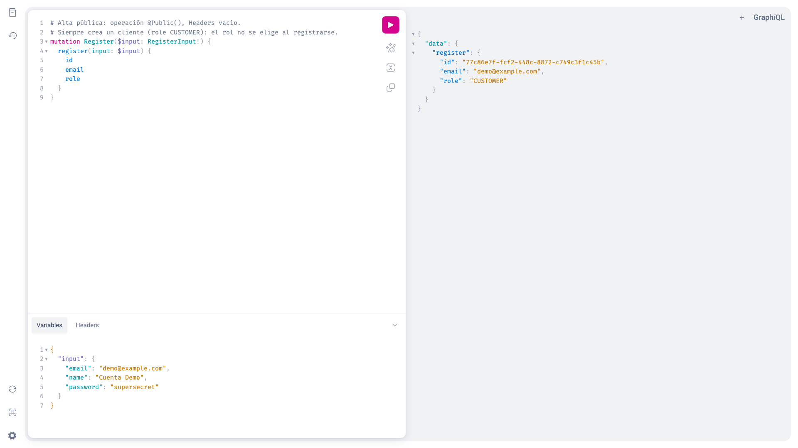

### 2. Login

Público. Devuelve el JWT (HS256), que caduca a los 900 s y es el que va en `Authorization: Bearer` en el resto de operaciones.

```graphql
mutation Login($input: LoginInput!) {
  login(input: $input) {
    accessToken
    tokenType
    expiresIn
  }
}
```

```json
{ "input": { "email": "demo@example.com", "password": "supersecret" } }
```

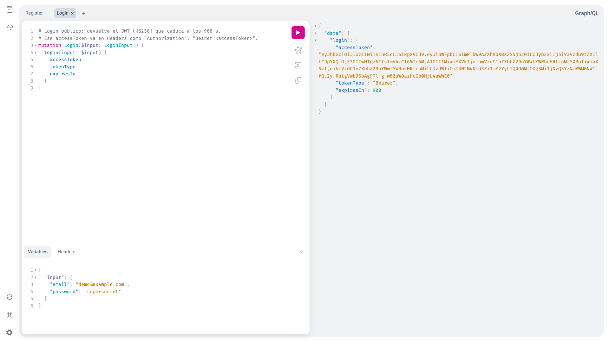

### 3. Me: quién soy según el token

No tiene argumentos: la identidad sale del JWT de la cabecera.

```graphql
query Me {
  me {
    id
    email
    name
    role
    createdAt
  }
}
```

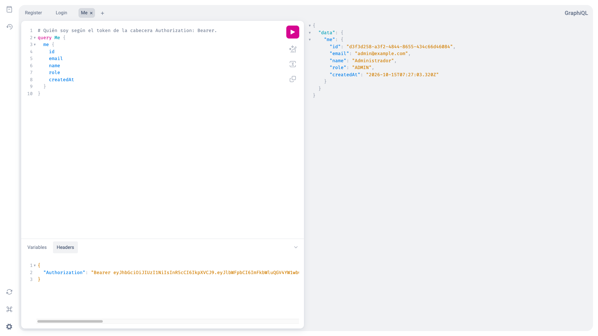

## Usuarios

### 4. Users: listado paginado (solo ADMIN)

```graphql
query Users($filter: UserFilterInput) {
  users(filter: $filter) {
    total
    page
    limit
    items {
      id
      email
      name
      role
    }
  }
}
```

```json
{ "filter": { "role": "CUSTOMER", "page": 1, "limit": 10, "sort": "DESC" } }
```

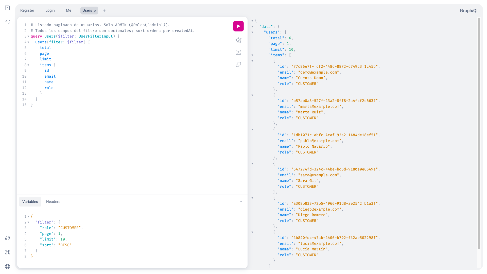
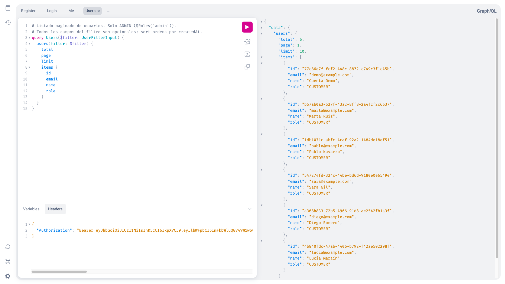

### 5. User: detalle (propietario o ADMIN)

```graphql
query User($id: ID!) {
  user(id: $id) {
    id
    email
    name
    role
    createdAt
  }
}
```

```json
{ "id": "<uuid-usuario>" }
```

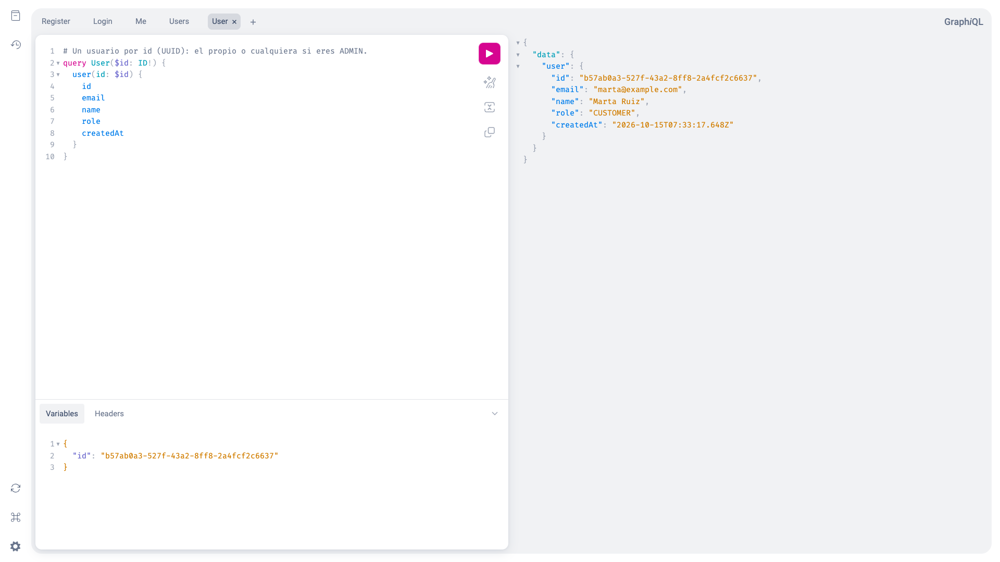
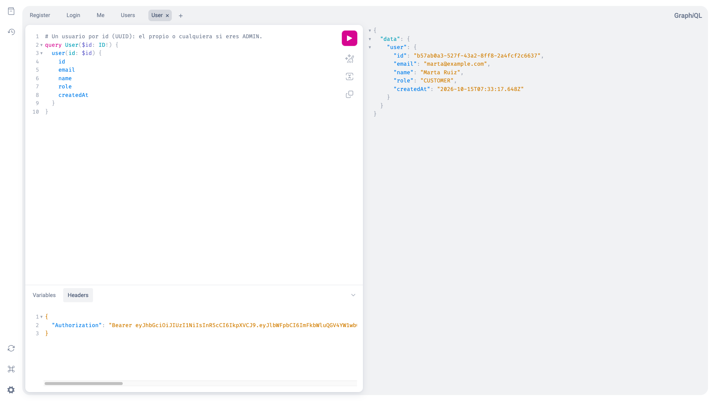

### 6. CreateUser: alta con rol (solo ADMIN)

La contraseña se guarda como hash scrypt y nunca aparece en la respuesta.

```graphql
mutation CreateUser($input: CreateUserInput!) {
  createUser(input: $input) {
    id
    email
    role
  }
}
```

```json
{ "input": { "email": "staff@example.com", "name": "Staff", "password": "supersecret", "role": "ADMIN" } }
```

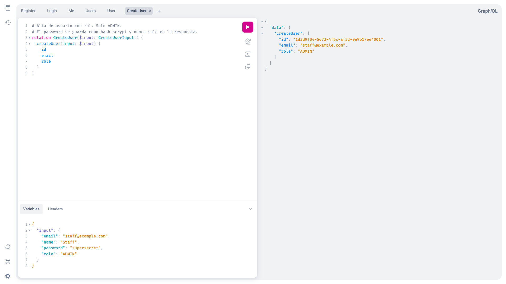
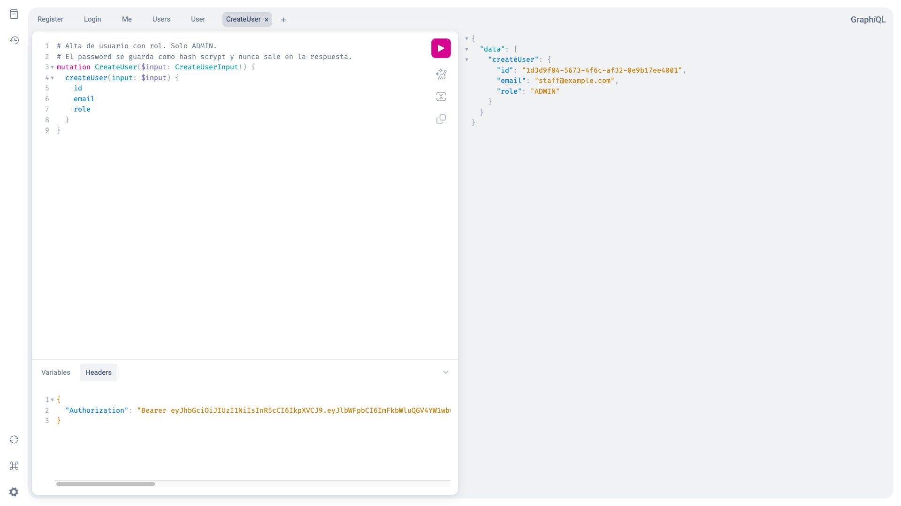

### 7. UpdateUser: edición parcial

Basta con un campo del input. El rol solo lo cambia un ADMIN.

```graphql
mutation UpdateUser($id: ID!, $input: UpdateUserInput!) {
  updateUser(id: $id, input: $input) {
    id
    name
    role
    updatedAt
  }
}
```

```json
{ "id": "<uuid-usuario>", "input": { "name": "Staff Editado", "role": "CUSTOMER" } }
```

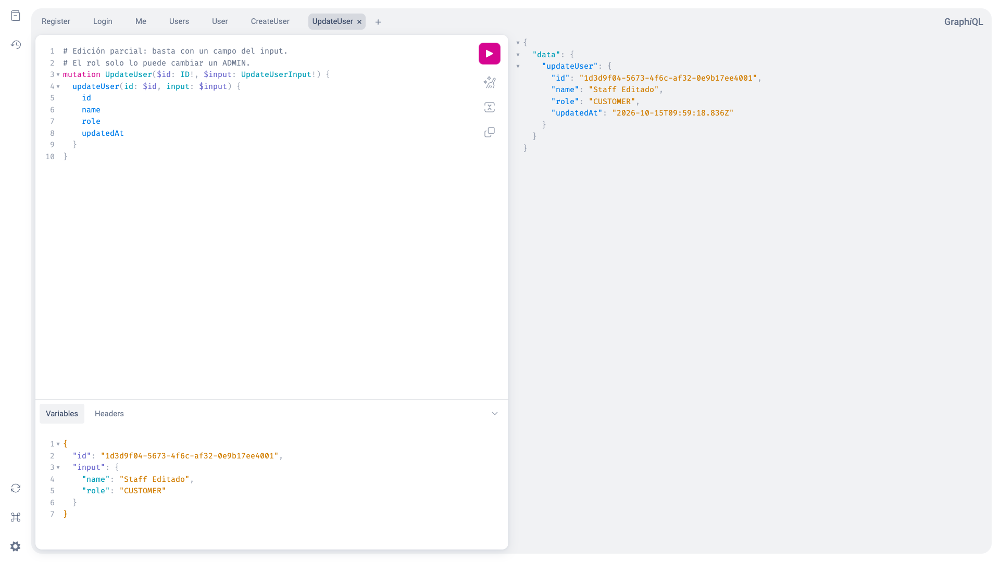
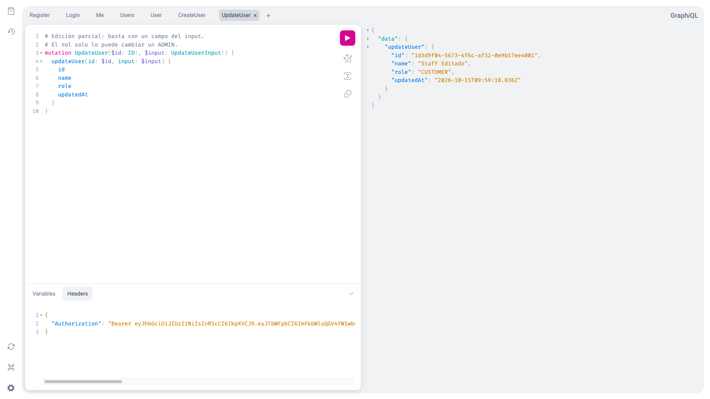

### 8. DeleteUser (solo ADMIN)

Devuelve `true`. Los pedidos del usuario se conservan, porque un pedido referencia a su usuario solo por id.

```graphql
mutation DeleteUser($id: ID!) {
  deleteUser(id: $id)
}
```

```json
{ "id": "<uuid-usuario>" }
```

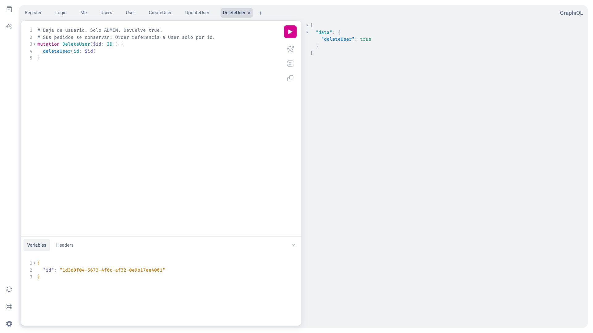
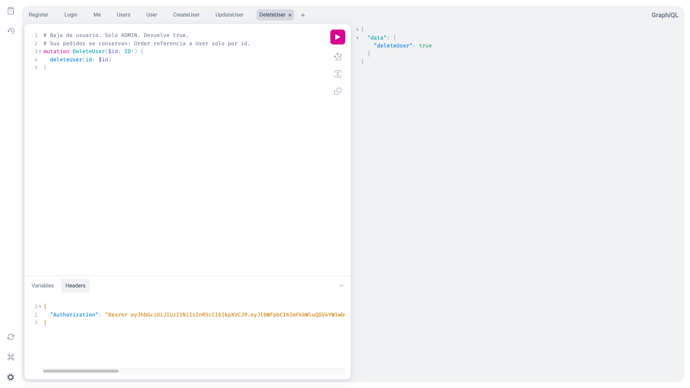

## Pedidos

### 9. Orders: filtros ESR

Igualdad (`status`, y `userId` si eres ADMIN), orden (`createdAt`) y rango (`totalCents`), en el mismo orden que los índices compuestos. Un cliente solo ve sus pedidos.

```graphql
query Orders($filter: OrderFilterInput) {
  orders(filter: $filter) {
    total
    items {
      id
      userId
      status
      totalCents
      items {
        sku
        quantity
        subtotalCents
      }
    }
  }
}
```

```json
{ "filter": { "status": "PAID", "minTotalCents": 1000, "maxTotalCents": 100000, "sort": "DESC", "page": 1, "limit": 10 } }
```


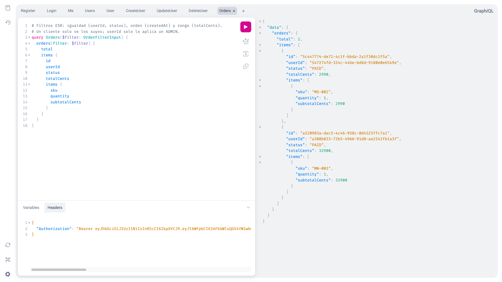

### 10. Order: detalle (propietario o ADMIN)

```graphql
query Order($id: ID!) {
  order(id: $id) {
    id
    status
    totalCents
    createdAt
    items {
      sku
      name
      quantity
      unitPriceCents
      subtotalCents
    }
  }
}
```

```json
{ "id": "<uuid-pedido>" }
```

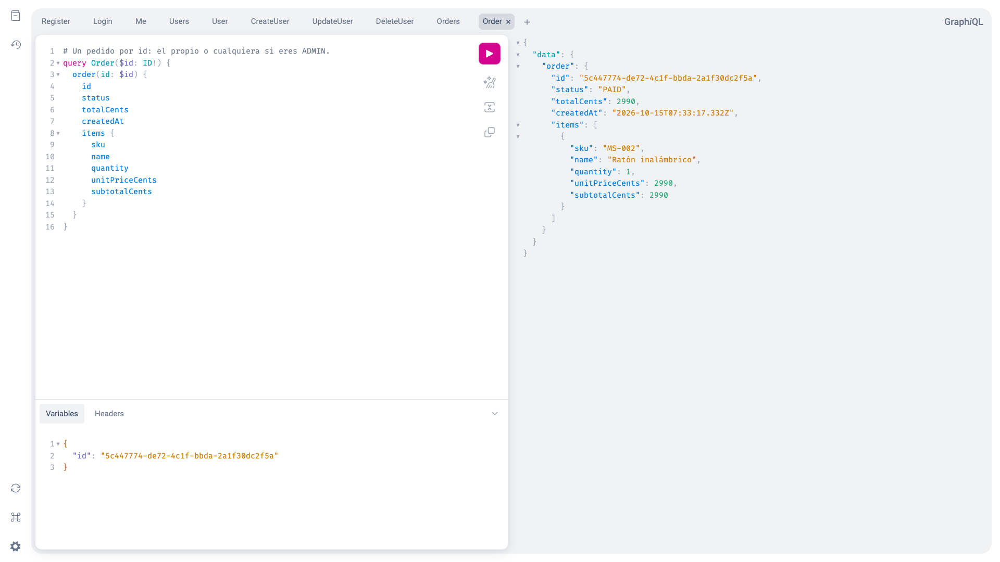
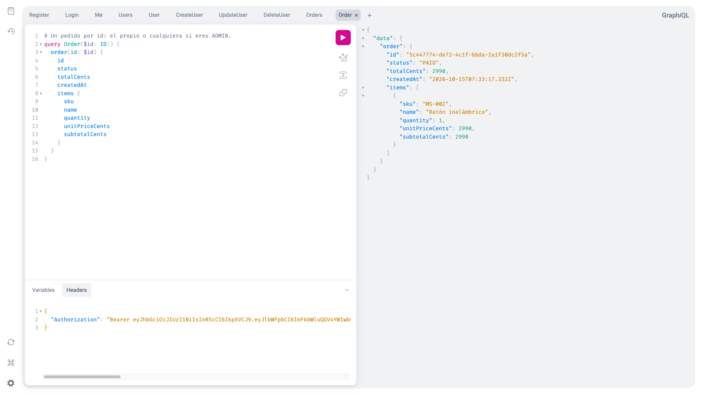

### 11. CreateOrder

Crea el pedido para el usuario del token, en estado `PENDING`. El total lo calcula el agregado `Order`: 8900 + 2 × 990 = 10880 céntimos.

```graphql
mutation CreateOrder($input: CreateOrderInput!) {
  createOrder(input: $input) {
    id
    status
    totalCents
    items {
      sku
      quantity
      subtotalCents
    }
  }
}
```

```json
{
  "input": {
    "items": [
      { "sku": "KB-001", "name": "Teclado mecánico", "quantity": 1, "unitPriceCents": 8900 },
      { "sku": "CB-004", "name": "Cable USB-C", "quantity": 2, "unitPriceCents": 990 }
    ]
  }
}
```

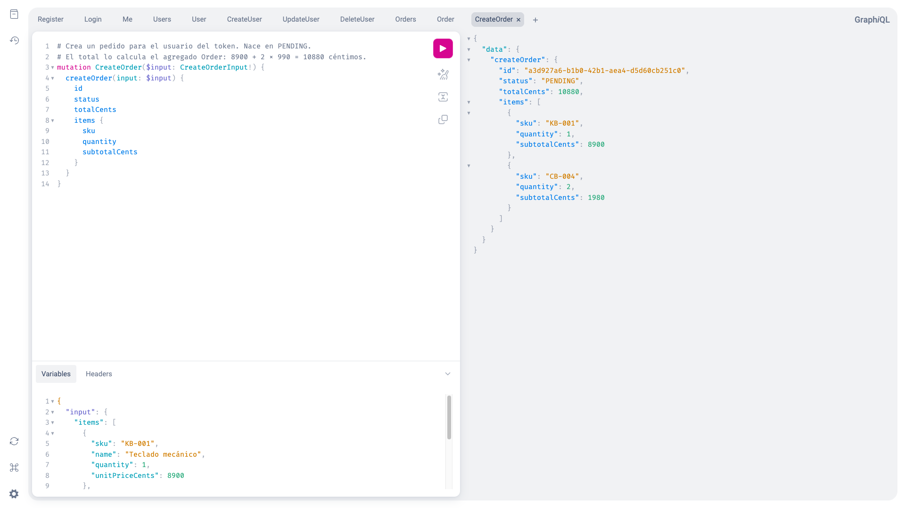
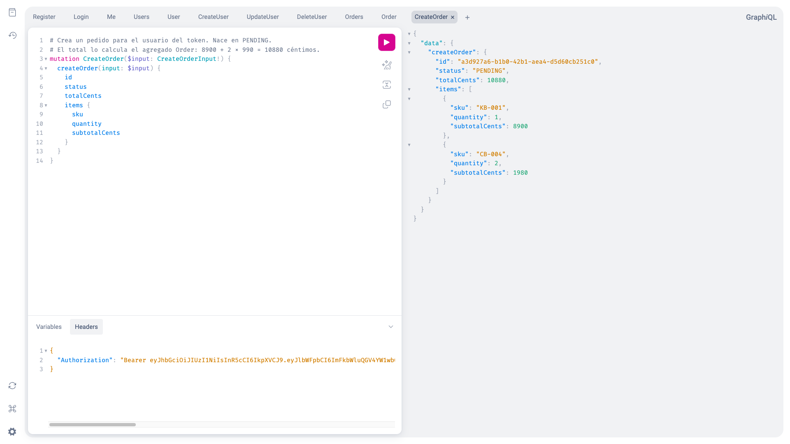

### 12. UpdateOrderStatus

Máquina de estados: `PENDING → PAID → SHIPPED`, y `PENDING` o `PAID → CANCELLED`. Un cliente solo puede cancelar sus pedidos; el resto de transiciones son de ADMIN.

```graphql
mutation UpdateOrderStatus($id: ID!, $status: OrderStatus!) {
  updateOrderStatus(id: $id, input: { status: $status }) {
    id
    status
    updatedAt
  }
}
```

```json
{ "id": "<uuid-pedido>", "status": "PAID" }
```

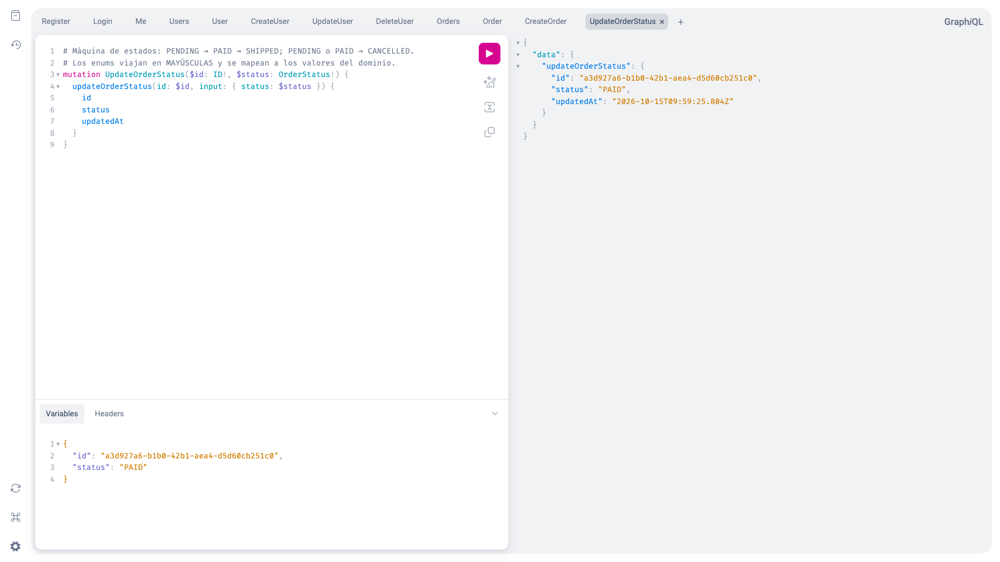
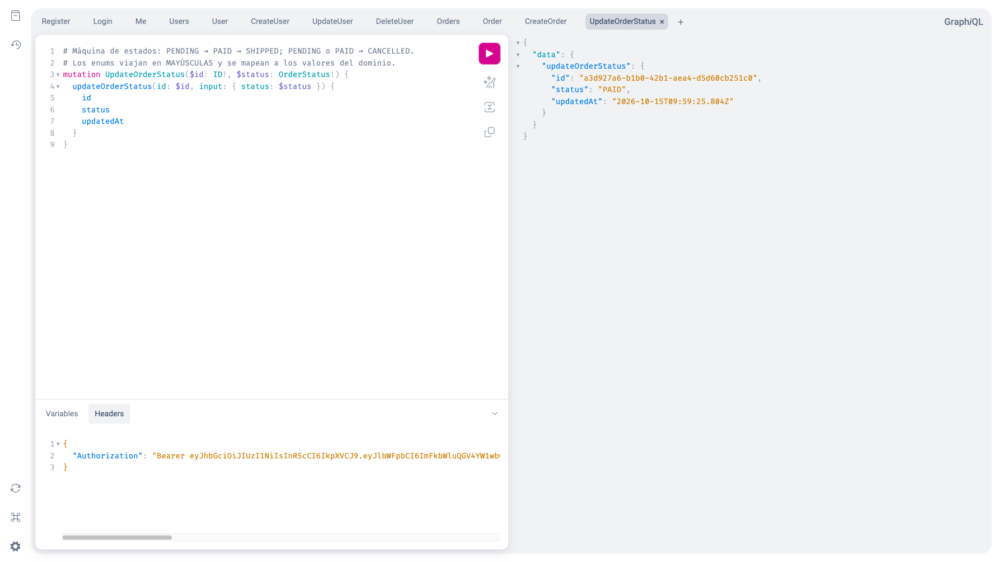

### 13. DeleteOrder (solo ADMIN)

```graphql
mutation DeleteOrder($id: ID!) {
  deleteOrder(id: $id)
}
```

```json
{ "id": "<uuid-pedido>" }
```

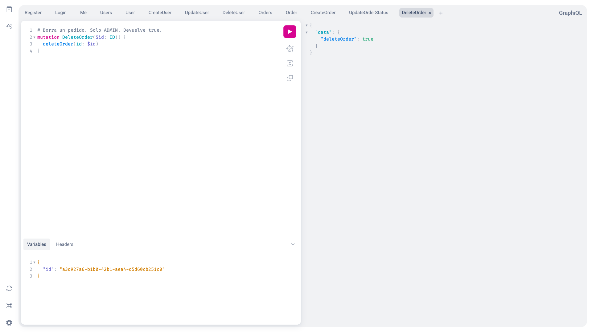
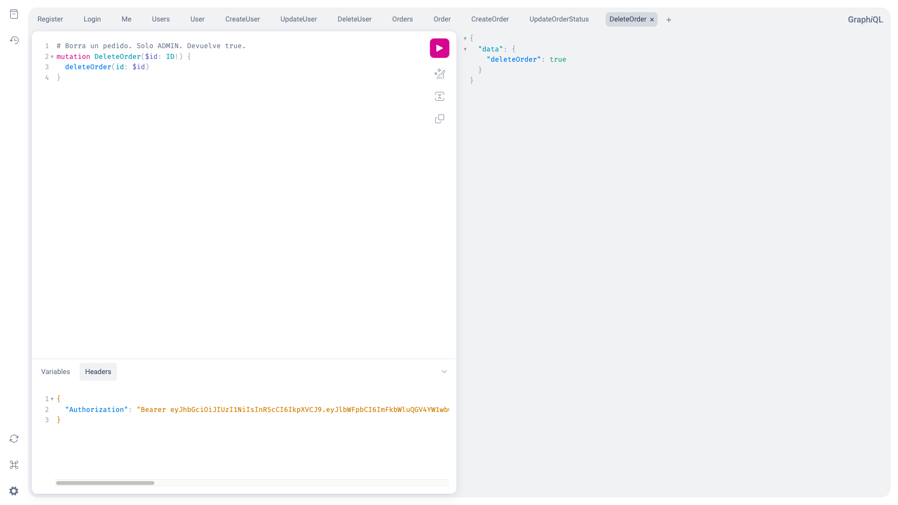

## Errores

GraphQL responde HTTP 200 también cuando hay errores. El código va en `errors[].extensions.code` y es el mismo que usa REST en Problem Details. En desarrollo, `extensions.stacktrace` incluye la traza; en producción se desactiva.

### 14. Transición no permitida: BUSINESS_RULE

`SHIPPED` es un estado terminal: la transición no está en la tabla y el dominio la rechaza (`status: 422` en `extensions`).

```graphql
mutation TransicionNoPermitida($id: ID!, $status: OrderStatus!) {
  updateOrderStatus(id: $id, input: { status: $status }) {
    id
    status
  }
}
```

```json
{ "id": "<uuid-pedido-enviado>", "status": "PENDING" }
```

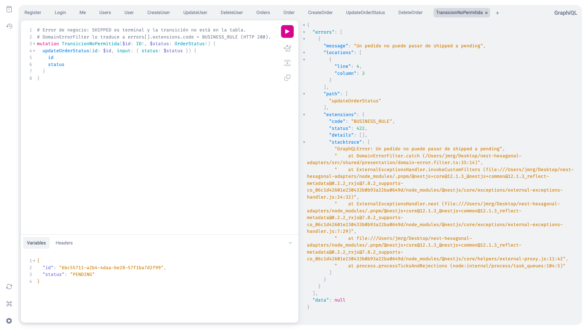
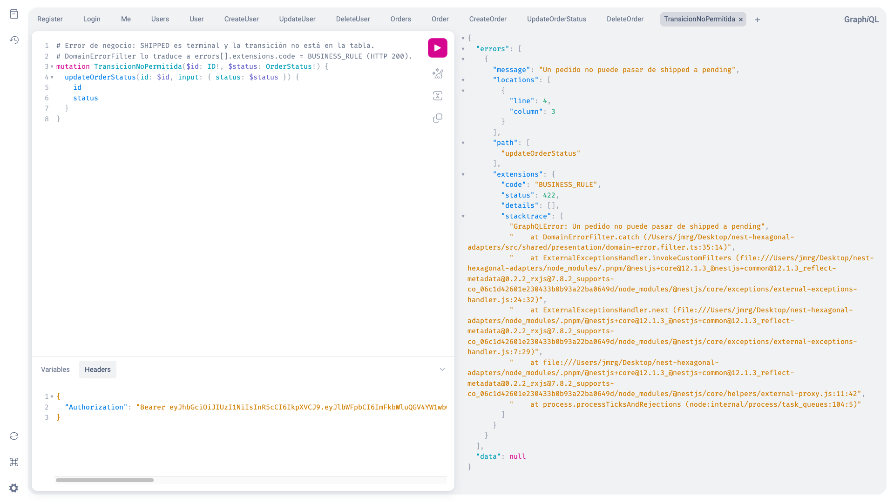

### 15. Sin token: UNAUTHENTICATED

La pestaña *Headers* va vacía a propósito. `JwtAuthGuard` es global, así que toda operación que no sea `@Public()` exige `Authorization: Bearer`.

```graphql
query MeSinToken {
  me {
    id
    email
  }
}
```

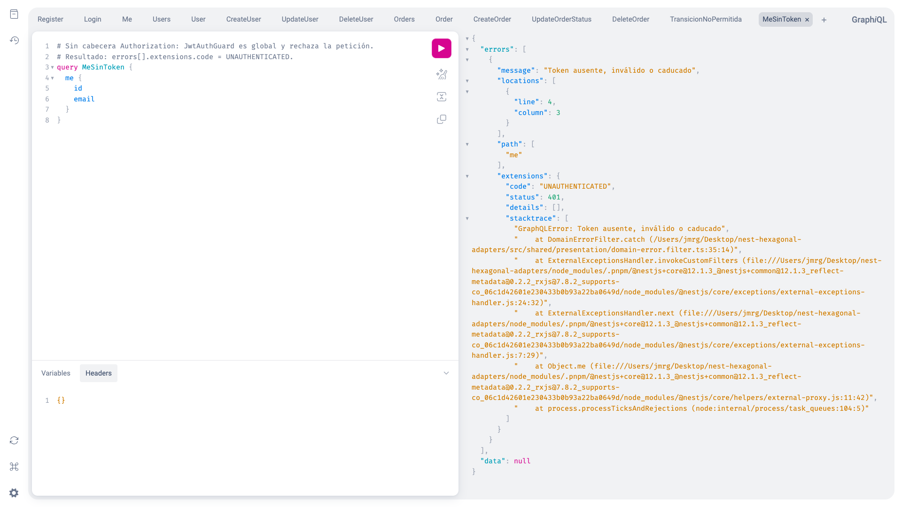

## Persistencia

### 16. Contenedores en Docker

`docker compose up -d` levanta las dos bases de datos del proyecto: `postgres:18-alpine` en el puerto 5432, para los drivers `prisma` y `sequelize`, y `mongo:7.0.45` en el 27017, para `mongoose`. La API corre fuera de Docker con `pnpm start:dev`.

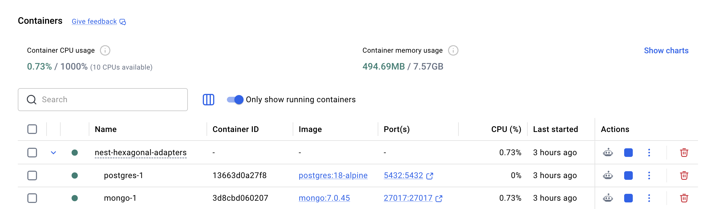

### 17. MongoDB en Compass

La conexión usa la misma URI que la API (`MONGO_URI` en `.env`), contra el contenedor `mongo` de `docker compose`:

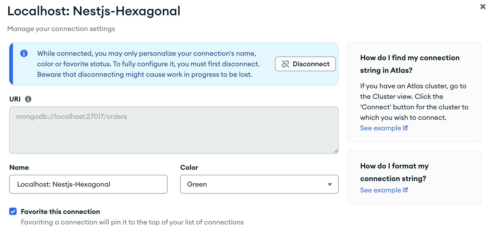

Con `DB_DRIVER=mongoose`, las operaciones anteriores se guardan en la base `orders` (`MONGO_URI=mongodb://localhost:27017/orders`), que tiene dos colecciones: `users` y `orders`. Las líneas del pedido no tienen colección propia: van embebidas en cada documento de `orders`, que es lo que separa este adaptador de los de PostgreSQL (Prisma y Sequelize), donde viven en la tabla hija `order_items`.

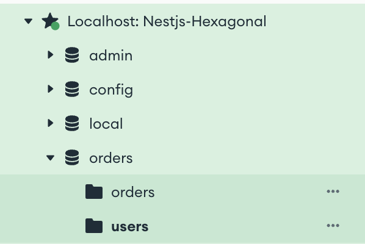

---

[← OpenAPI, Postman y GraphQL](../05-openapi-postman-graphql.md) · [Índice](../../README.md#documentación) · [Diagramas →](../diagrams/README.md)
