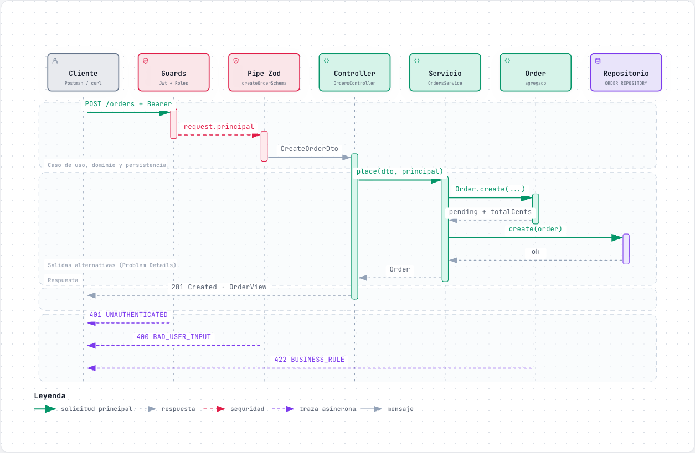
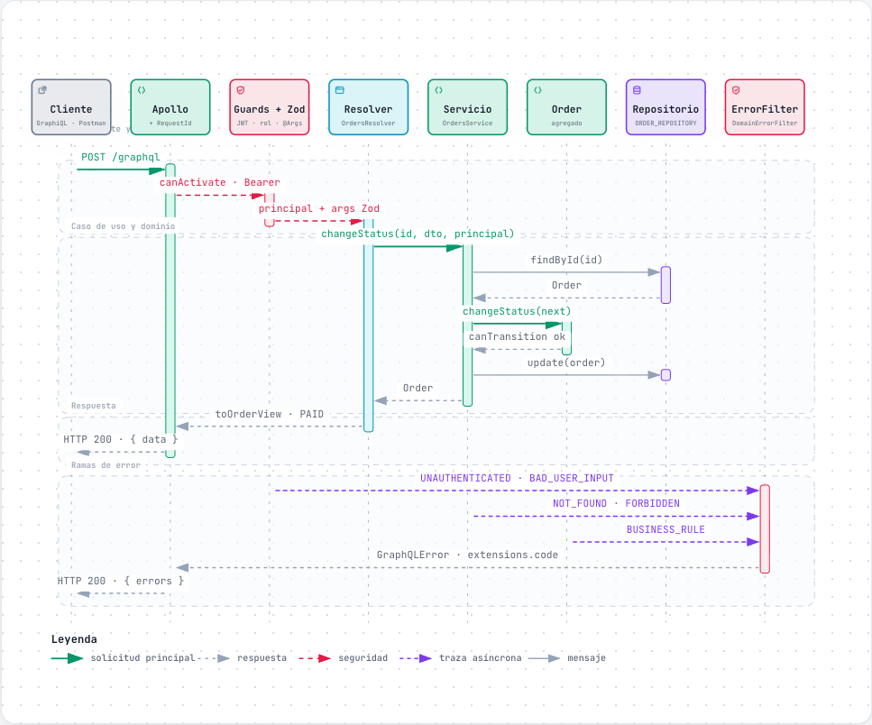
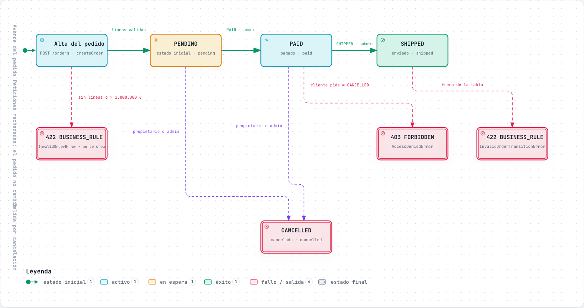
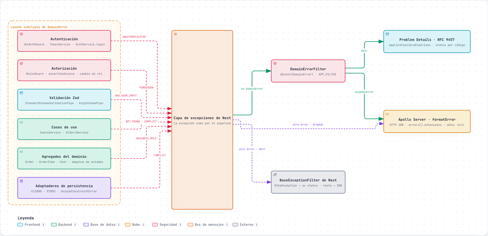
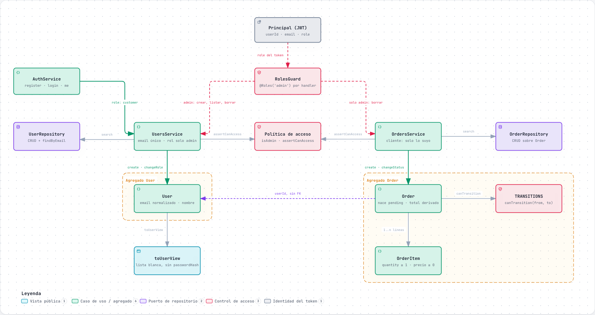

# Diagramas

Seis diagramas interactivos que explican el proyecto, desde la estructura hasta el último error. Las miniaturas enlazan al HTML, que es autocontenido: se abre directamente en el navegador, sin dependencias externas.

> [!TIP]
> En el HTML hay zoom, búsqueda, tema claro y oscuro, modo **Ruta** para seguir un camino, modo **Lente** para aislar un componente y exportación a PNG o SVG. Cada diagrama termina con una tarjeta «Dónde está en el código» con las rutas `archivo:línea`.

> [!NOTE]
> GitHub y los gists muestran el código fuente de un `.html`, no la página. Para verlos renderizados, descárgalos o publícalos con GitHub Pages.

**Orden de lectura:** [01](#01--arquitectura-hexagonal) para la estructura → [06](#06--dominio-y-reglas-de-negocio) para el negocio → [02](#02--secuencia-rest-crear-pedido) y [03](#03--secuencia-graphql-cambiar-estado) para el recorrido de una petición → [04](#04--ciclo-de-vida-del-pedido) para el pedido → [05](#05--manejo-de-errores) para los errores.

## 01 · Arquitectura hexagonal

Entradas REST y GraphQL, pipeline de Nest, servicios, dominio con sus puertos y los cuatro adaptadores de persistencia que elige `DB_DRIVER`. Las dependencias apuntan hacia el dominio.

## 02 · Secuencia REST: crear pedido

`POST /orders` de punta a punta: guards, validación Zod, `Order.create`, repositorio y `201 Created`, con las salidas 401, 400 y 422.

## 03 · Secuencia GraphQL: cambiar estado

`updateOrderStatus`: el mismo caso de uso que en REST, un único endpoint y los errores en `errors[].extensions.code`, con HTTP 200.

## 04 · Ciclo de vida del pedido

Máquina de estados `PENDING → PAID → SHIPPED` y `CANCELLED`, quién puede disparar cada transición y qué se rechaza sin cambiar el pedido.

## 05 · Manejo de errores

De dónde sale cada `DomainError`, con qué código, y cómo `DomainErrorFilter` lo traduce a Problem Details (REST) o a `GraphQLError` (GraphQL). Incluye la rama de los errores que no son de dominio.

## 06 · Dominio y reglas de negocio

Agregados `User` y `Order` + `OrderItem`, invariantes, referencia entre agregados solo por id y políticas de acceso por rol y por propiedad.

---

[← Documentación](../../README.md#documentación) · [Operaciones GraphQL con capturas →](../capturas/queries-graphql.md)
